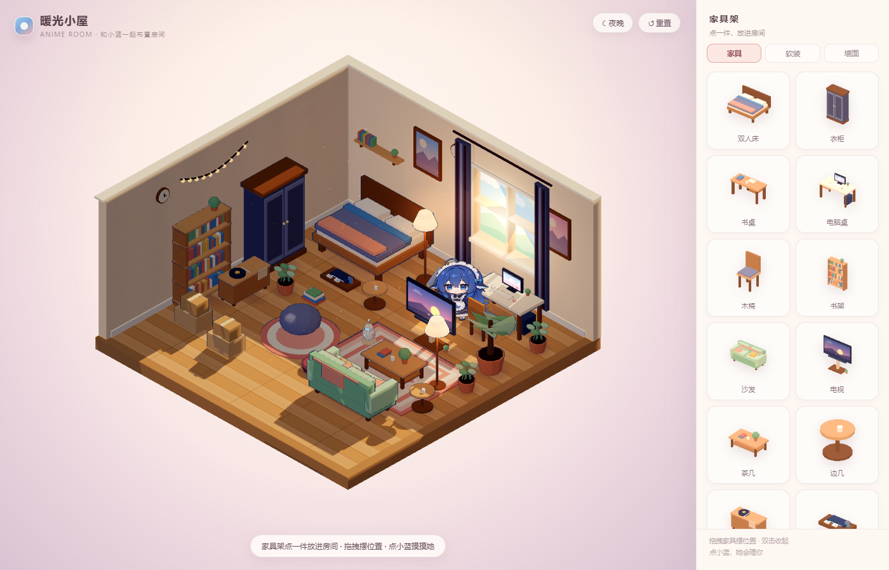
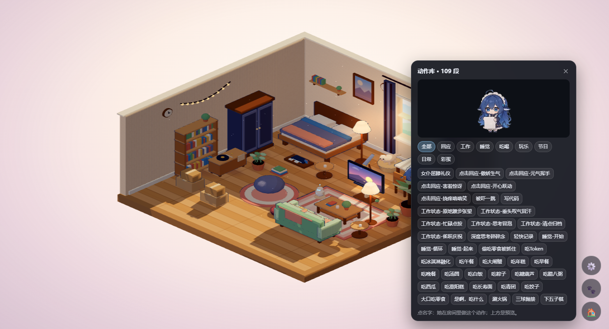

# 暖光小屋 · Cozy Room

一个**动漫风等距小屋**：可以自由摆放家具，屋里住着蓝发女仆「小蓝」。
她会在房间里走动、吃饭、打盹、看窗外；你在 DSH 里工作时，她也会在电脑前忙。

- 🏠 **独立网页**：双击 `anime-room/index.html` 就能玩（纯静态、离线可用）
- 🧩 **DSH 插件**：`dsh-cozy-room` 把同一间屋子做成窗口背景层，附带桌宠召回、动作库、工作状态联动




## 快速开始

### 只想玩房间

```text
双击 anime-room/打开小屋.bat   （或直接打开 anime-room/index.html）
```

> 想用全套 109 段动作，用 http 打开：`cd anime-room && python -m http.server 8000`，
> 然后访问 <http://127.0.0.1:8000>。

### 想装成 DSH 背景

```bash
cd dsh-cozy-room
npm install          # 可选，仅用于本地验证
# 在 DSH 插件管理器里安装这个目录，或 dsh plugin install dsh-cozy-room
```

> **需要透明主题**：房间是背景层，如果 DSH 窗口背景不透明就会把它盖住。装一个透明/玻璃主题（例如壁纸引擎的「液态玻璃」），并且只开一个管背景的主题插件。

装好后刷新 Web UI（Ctrl+R），右下角会出现 **⚙️ / 🐾 / 🏠**。

> 从源码安装时注意：dsh-cozy-room/room/ 是构建产物、不入库。
> clone 后先在 dsh-cozy-room 里跑一次 
pm run sync-room，否则宿主找不到 
oom/index.html 会静默退出。

## 功能

- **等距 8×8 房间**：粉彩卡通渲染、昼夜切换、程序化家具（床、书桌、沙发、电视、电脑、游戏机、机器人、望远镜…）
- **自由布置**：放置 / 拖拽 / 旋转 / 收起，布局自动存 `localStorage`
- **角色**：109 段透明动画（待机、工作、睡觉、吃喝、玩乐、节日、彩蛋…），随机走动，每个落脚点 1–8 个动作后换位置
- **工作联动**：思考 → 思考冒泡；调工具 → 写代码；完成 → 开心跃动；出错 → 被吓一跳
- **召回桌面（🐾）**：从壁纸里跳出来变成桌宠，点她挥手、拖她换位置；睡着时要连点 3–5 下才会被叫醒
- **动作库（🎬）**：109 段按分类浏览，点一下她就在房间里演给你看
- **猫咪**：自己溜达、打盹、回窝

## 仓库结构

```
anime-room/      # 房间源码（开发用）
dsh-cozy-room/   # DSH 插件包（room/ 由 npm run sync-room 生成，不入库）
TASKS/ REPORTS/  # 任务卡与交接报告
HANDOVER.md      # 架构 / 行为契约 / 已知坑（接手必读）
WORKBUDDY.md     # 协作规则
```

## 许可证

- **代码**：MIT（见 `LICENSE`）
- **角色动画**：来自 [dsh-pet](https://github.com/PC2005-cloud/dsh-pet)（作者 PC2005-cloud），**禁止商用、公开渠道须署名**；详见 `anime-room/CREDITS.md`

> 也就是说：这个项目可以免费分享、二创，但不能拿去做付费产品；转发/二次发布请保留 dsh-pet 的链接与作者名。
