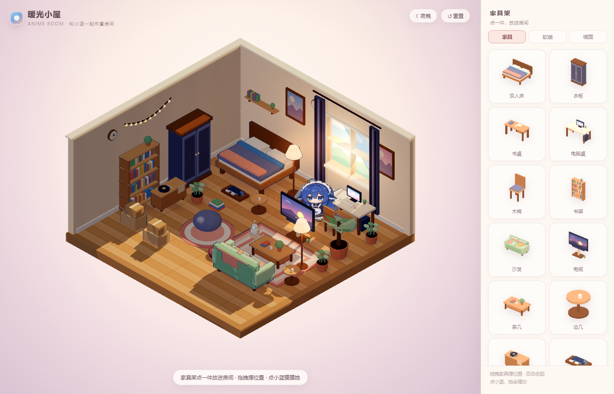
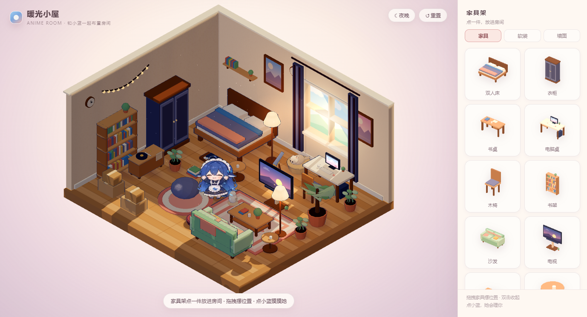
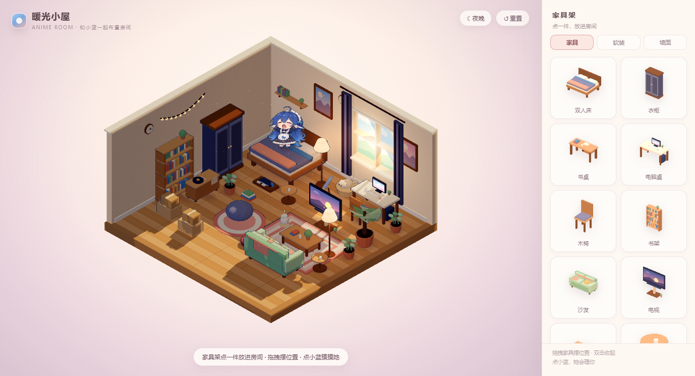
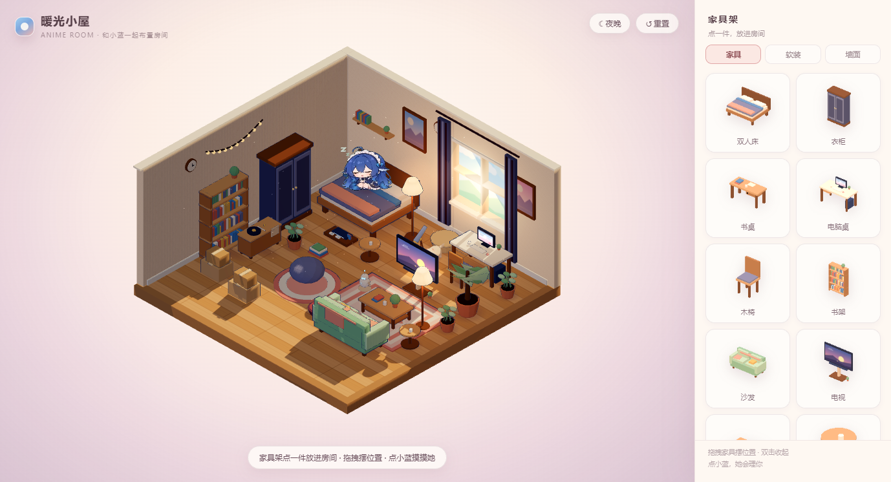
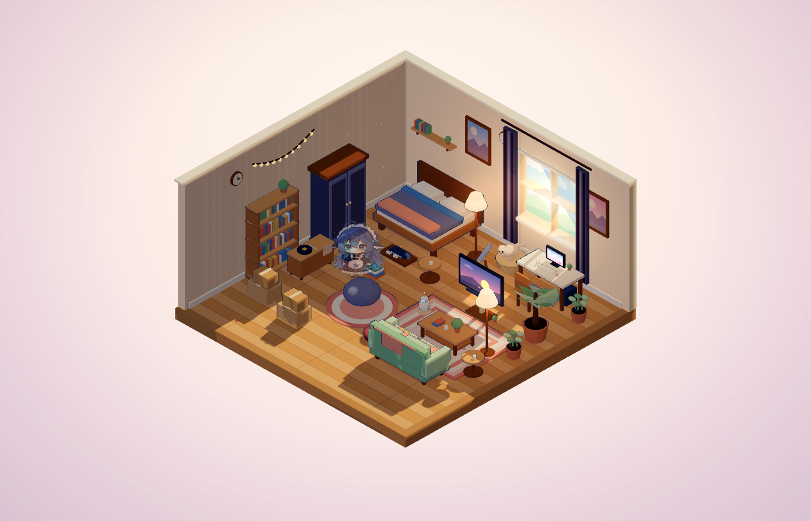

# 暖光小屋 · Cozy Room（动漫版）

一个可以自由布置的**动漫风小屋**，屋里有位蓝发女仆小人「小蓝」。房间是 8×8 的正方形，整体在画面里收小了一圈，四周留出呼吸感。这是小蓝（和 AI）的家，所以屋里还摆了一个会眨眼的小机器人和一台对着窗外的望远镜。

主角**直接用 DSH 桌宠插件 `dsh-pet` 自带的透明 webm 动画**：待机呼吸、点击回应、睡觉三段，原样播放，不再是手绘立绘。

**独立网页，不依赖 DSH**：双击 `index.html` 就能玩（完全离线）；同时它也被做成了 **DSH 的背景层**（见文末）。






## 打开

- 双击 `index.html`，或双击 `打开小屋.bat`
- 浏览器需要支持 WebGL 和支持 VP9 alpha 的 webm（Chrome / Edge / Firefox）

## 玩法

| 操作 | 说明 |
| --- | --- |
| 家具架点一件 | 进入放置模式，鼠标上出现半透明预览 |
| 点地板 | 放下家具（绿色=能放，红色=放不下），可连续放 |
| 拖拽家具 | 移动已放好的家具 |
| 双击 / 右键 / Delete | 收起家具 |
| R | 旋转手上的预览，或旋转选中的家具 |
| Esc | 取消放置 / 取消选中 |
| 点小蓝 | 播放「点击回应」动画；睡着的会被叫醒 |
| ☾ 夜晚 / ☀ 白天 | 切昼夜：夜里落地灯、彩灯串亮起，背景变成夜色 |
| ↺ 重置 | 恢复最初的布置 |
| 墙面 tab | 挂画、挂钟、彩灯串、壁架：选中后点墙面挂上去 |

布置会自动存进浏览器 localStorage，下次打开还是你的房间。

## 角色（dsh-pet 桌宠）

- 19 段动画都来自 dsh-pet/assets/webm/，**640×360、VP9 带 alpha**，直接当视频纹理用：
  - 待机：待机呼吸休闲
  - 互动：点击回应-元气挥手（点她）、点击回应-开心跃动（放好家具）
  - 睡觉：睡觉-开始 → 睡觉-循环，醒来 睡觉-起来 —— 困了会挪到床上，用原来的睡觉姿势（不盖被、不躺平）
  - 办公：写代码 / 工作状态-思考冒泡 / 工作状态-忙碌点按 —— 会挪到电脑桌前
  - 生活：撸猫、吃白饭、超大伸懒腰、鲸鱼吐泡泡特效、东张西望、哈欠连天、吃冰淇淋融化、照镜子、被吓一跳、吹气球
- 没人理时每 12–22 秒换一个小动作，动作**洗牌不连着重复**；每次回房间会换一个**随机空位**，不会老站在中间
- **和你联动**：你在 DSH 里思考、调工具的时候，她会自动去电脑桌前**一直做「思考」动作**（工作状态-思考冒泡 循环）；你停下来，她才接着自己玩
- **先自己玩 10 分钟左右**才去床上睡觉（点她可随时叫醒）
- 位置切换用**淡出淡入**（不走路、不闪现）：随机空位 / 床上（原姿势）/ 电脑桌前
- 视频只取人物所在的一块区域（裁掉透明边），做成朝向相机的 billboard，脚下有接触阴影
- 视频以 data URL 内嵌（js/pet-videos.js），所以 ile:// 双击也能播，不受本地文件跨域限制

## 画风 / 技术

- **Three.js r160**（本地 `js/three.min.js`，离线）
- **视频桌宠**：`<video>` + `THREE.VideoTexture`，`transparent` + `alphaTest`，sRGB 采样；换动作时暂停旧视频、切纹理、从头播
- **卡通渲染房间**：`MeshToonMaterial` + 4 阶色阶贴图，反向外壳描边；粉彩配色、木地板、窗景、绿植、猫、地毯
- **鼠标视差**：鼠标在窗口里移动时，相机做很小的平移（±0.55 单位），房间会跟着微微晃；背景层由父页面 postMessage 把指针坐标传进 iframe，独立打开时直接监听画布 pointermove
- **会走动的猫**：不再固定在猫窝里——它在房间四处走动、随机打盹，走累了回猫窝睡；落点随机、用比人更小的碰撞边距避开家具
- **柔光**：暖色平行光从窗洞投射 + 接触阴影，昼夜两套灯光
- **自由布置**：网格吸附、碰撞检测、旋转、墙面贴挂、localStorage 存档
- **家具**：床、衣柜、书桌、电脑桌（显示器 + 主机）、电视（立式）、游戏机（含手柄和卡带）、小机器人、望远镜、书架、沙发、茶几、边几、唱片柜、懒人沙发、收纳箱、地毯、落地灯、绿植、猫窝、坐垫、旧书堆、壁架、挂画、挂钟、彩灯串
- 家具和房间贴图都是**程序化生成**；只有桌宠动画来自 `dsh-pet`

## 文件

```
anime-room/
├─ index.html
├─ styles.css            奶油+粉的动漫 UI（含夜间主题）
├─ js/
│  ├─ three.min.js       Three.js r160
│  ├─ assets.js          调色板、程序化贴图、卡通材质、低多边形家具
│  ├─ world.js           渲染器、等距相机、房间、灯光、昼夜
│  ├─ pet-videos.js      dsh-pet 的 13 段 webm → data URL
│  ├─ video-pet.js       视频桌宠（采样区域、透明、billboard、动作切换）
│  ├─ fx.js              爱心 / Zzz 粒子（预留，当前动作由视频自带）
│  └─ app.js             布置系统、点击交互、待机犯困、存档、UI
├─ assets/webm/          13 段 webm 原始文件（可替换成别的动作）
├─ preview/              白天 / 办公 / 睡觉 / 点击回应 / 作为 DSH 背景
├─ CREDITS.md            素材出处与公开仓库注意事项
└─ 打开小屋.bat
```

> 旧的 2D 立绘（`assets/pet-*.png`、`js/pet-assets.js`）已不再加载，文件保留在目录里当备份。
> 之前的像素版还留在 `../purple-room/`，两版互不影响。
> 改动作：把新的透明 webm 放进 `assets/webm/`，重新生成 `js/pet-videos.js`（或直接改里面的 data URL）即可。

## 作为 DSH 背景（壁纸层）

小屋也被做成了 DSH 客户端插件 **`dsh-cozy-room`**，装进 `profiles/desktop` 后它会在 DSH 窗口里铺一层全屏背景：

- 宿主端在 `127.0.0.1:8136` 提供房间页面（`?embed=1` 只渲染房间，隐藏家具架和标题）
- 客户端插入一个 `position: fixed` 的 iframe（`z-index:-1`、`pointer-events:none`），房间就铺在聊天面板后面，露出留白、卡片缝隙和输入框周围
- 右下角的 **🏠** 按钮进入「可交互模式」：房间浮到最前、可以拖家具、点小蓝、切换昼夜；**Esc** 或 **✕** 退出
- 入口文件：`../dsh-cozy-room/`（`lib/index.js` 静态服务、`lib/client.js` 背景层、`cordis.patch.yml` 注册）

参数：`?embed=1` 背景模式，`?night=1` 直接夜晚，`?embed=1&night=1` 夜晚背景。



## 后面可以加

- 从 `dsh-pet` 的 140 段动画里再挑几段做随机待机（撸猫 / 写代码 / 鲸鱼吐泡泡 / 原地小憩…）
- 背景层和 DSH 状态联动：思考、后台任务、审批时让小蓝做对应动作（参考之前互动壁纸的方案）
- 需要的话再把同一套场景嵌回 DSH 插件


## 素材来源 / 公开到 GitHub

- 房间、家具、UI、交互代码：本项目原创
- 19 段桌宠动画：来自 **dsh-pet**（https://github.com/PC2005-cloud/dsh-pet），作者 PC2005-cloud
  - 其许可：**代码 MIT；素材禁止商用；二创在公开渠道须注明出处**
- 公开仓库时：保留 CREDITS.md 与 dsh-pet 链接、不要商用；最稳妥的做法是让 ssets/webm/ 不进入仓库（.gitignore 里有注释开关），使用者自己从 dsh-pet 取素材


## 我能直接操控她（指令通道）

房间每秒轮询 cmd.json，写一条命令就能让她做事（我或你都可以写）：

`json
{ts: 1, action: sleep}
{ts: 2, action: go, x: 3.2, z: 5.4}
{ts: 3, action: balloon}
`

- 动作：idle / sleep / wake / go(x,z) / stop / code / 	hink / usy / cat / eat / stretch / ubbles / look / yawn / icecream / mirror / scared / alloon / wave / cheer
- 手动命令会**压过自动状态机和工作联动 30 秒**，之后她继续自己生活
- 关于「数字生命」：现在是我在对话里随时操控 + 她自己的自主行为；要做到我不在时也“活着”，可以再加一层定时决策（DSH 定时任务）/ 本地生命引擎


## 她的生活（由“她”自己定的作息）

按本地时间过日子，而不是一直随机：

| 时间 | 在做什么 |
| --- | --- |
| 23:00–07:00 | 夜里：2 分钟没人理就上床睡，夜里不会自己醒（除非你工作把她叫起来） |
| 07:00–09:00 | 早晨：伸懒腰、看窗外、吃早饭 |
| 09:00–12:00 / 14:00–18:00 | 白天：去桌前写代码/忙碌；你在工作时她固定“思考” |
| 12:00–14:00 | 午饭：吃白饭、冰淇淋 |
| 18:00–22:00 | 傍晚：撸猫、吹泡泡、照镜子、玩 |

- **精力**：工作会掉精力，吃饭/冰淇淋/睡觉会回精力；精力低时更容易打哈欠、发呆
- 手动指令仍然优先（30 秒），随时可以打断她的日常


## 设置（⚙️ 按钮）

右下角 🏠 上面还有一个 ⚙️，点开就能设置她：

- 开关：跟着我工作 / 夜里会睡觉 / 在房间里走动 / 猫会走动 / 鼠标带动房间
- 活动频率：安静 / 正常 / 活泼
- 大小：0.75–1.35 的滑块

设置存在本机，改完立刻生效；背景层里由父页面把设置 postMessage 给房间，房间也把自己的设置存进 localStorage。


## 召回到桌面（🐾）

右下角按钮组现在是：⚙️ 设置 / 🐾 召回 / 🏠 进房间。

- 点 **🐾**：把她从壁纸里叫出来，变成浮在窗口上的桌宠（透明视频，160×180）
- **登场效果**：光晕 + 白色闪环 + 星光粒子，之后先「疑惑」（害羞惊讶）约 2.6 秒，再挥手打招呼，最后回到待机/夜里睡觉
- 特效可在设置里选：星光 / 爱心 / 泡泡 / 光环 / 无
- 叫出来后房间里的她会暂时消失（通过 cozy-room-presence 消息）
- 在桌面上时她不会自动睡着；**1–5 分钟没人和她互动，她会自己回房间**
- 桌面上的互动：
  - 点她 → 挥手
  - 拖动 → 换位置（位置会记住）
  - 悬停 → 头顶出现 💤 睡觉 / 💻 工作 / ↩ 回房间
- 再点一次（图标变成 ↩）→ 送回壁纸，房间里的她回来


## 动作库（109 段，全部来自 dsh-pet）

| 分类 | 动画 | 用在哪 |
| --- | --- | --- |
| 待机 | 待机呼吸休闲 | 平时循环 |
| 回应 | 点击回应-元气挥手 / 害羞惊讶 / 开心跃动 | 点她 / 召回登场 / 成功 |
| 工作 | 工作状态-思考冒泡 / 写代码 / 工作状态-忙碌点按 | 思考 / 用电脑 / 忙按 |
| 睡觉 | 睡觉-开始 / 循环 / 起来 | 夜里、犯困 |
| 生活 | 东张西望、哈欠连天、超大伸懒腰、吃白饭、吃冰淇淋融化、照镜子、被吓一跳、吹气球、撸猫、鲸鱼吐泡泡特效 | 日常随机 |

这 109 段全部复制到了 ssets/webm/，分类是：回应 / 工作 / 睡觉 / 吃喝 / 玩乐 / 节日 / 日常 / 彩蛋。

## 工作状态 → 动作（跟我绑定）

宿主把这些状态写进 /status.json 的 state 字段，房间轮询后切换：

| 状态 | 触发 | 动作 |
| --- | --- | --- |
| 	hinking | 回合开始 | 思考冒泡 |
| working | 工具调用 | 写代码（用电脑） |
| waiting | 等你审批 | 思考冒泡 |
| success | 回合正常结束 | 开心跃动（约 4 秒） |
| error | 回合出错 | 被吓一跳（约 4 秒） |
| idle | 空闲 | 回到自己的日常 |


## 动作库面板（点一下就演）

设置面板底部有 **🎬 打开动作库**：

- 顶部是预览窗（选中动作的循环预览）
- 下面按 **全部 / 回应 / 工作 / 睡觉 / 吃喝 / 玩乐 / 节日 / 日常 / 彩蛋** 分类
- 点任意动作名：预览窗立即播放，同时房间里的她会做这个动作（背景模式）
- 109 段清单来自 dsh-pet，文件都在 anime-room/assets/webm/


## 换位置的规则

两套随机触发并行，谁先到谁触发：

1. **动作计数**：每个落脚点做 1–8 个动作（随机），做完当前动作直接淡出换位置（不用先东张西望）
2. **东张西望**：只要播了「东张西望」，播完必换位置

- 随机位置限制在离墙约 1.25 米以内，避免站进墙里
- 动作间隔 8–16 秒（受设置里的活动频率影响）
- 设置里关掉「在房间里走动」，她就固定待在原地


## 睡觉时的召回

- 她睡着时，右下角召回按钮会变成 **💤**
- 点一下**没有任何反应**：房间里她在睡觉，不会被打扰，也没有提示
- 需要连点 **3–5 下**（每次睡眠随机）才会真的把她叫到桌面
- 叫出来之后才会露出「生气 / 惊讶」的表情（登场动画）
- 点 ↩ 送回去，她**醒着**开始新的动作，不会继续睡

## 回房间的特效

- 点 ↩ 送回时，桌面卡片先按设置里的「召唤特效」爆一圈粒子，再缩小淡出
- 场景里的落点同时出现光晕、扩散环和火花（蓝色系），表示她“回来了”
- 如果她刚在睡觉，落地后会直接回床上继续睡


## 回到房间之后

- 落地特效放完，立刻开始一个**新动作**（上一次没做完的动作直接丢掉，不会接着播）
- 新动作会换到新的落脚点
- 例外：如果她刚才在睡觉，就不重新开始动作，而是回床上继续睡


## 分享与打包

### 独立版（双击即玩）

- 直接发 nime-room/ 整个文件夹（约 75 MB），里面的 打开小屋.bat 双击即可
- 想让 **109 段动作库全部可用**，用本地 http 打开（file:// 下 89 段额外动作不能上 3D 角色）：
  python -m http.server 8000，然后访问 http://127.0.0.1:8000
- 想瘦身：删掉 ssets/webm/ 和 js/pet-videos.js（约 −63 MB），角色动作会缺失；或只留常用的 20 段

### 体积构成

| 内容 | 大小 |
| --- | --- |
| js/pet-videos.js（20 段内嵌） | 10.4 MB |
| ssets/webm/（109 段） | 52.7 MB |
| preview/ 截图 | 约 9 MB（可删） |
| 代码 + three.js | 约 1 MB |

### 插件版（DSH 背景层）——分享前还要做一步

- dsh-cozy-room/lib/index.js 里的房间路径目前是**写死的绝对路径**，别人装了看不到房间；分享前要改成相对路径或配置项
- 端口 8140 写死（可用环境变量覆盖，但 client 端没读），两台机器/两个实例会冲突
- 还缺：安装说明、把 nime-room 一起打包进插件目录

### 许可证

- **代码**：MIT，见 LICENSE
- **角色动画素材**（来自 dsh-pet）：禁止商用、公开渠道须署名，见 CREDITS.md；想商用要自己换素材
