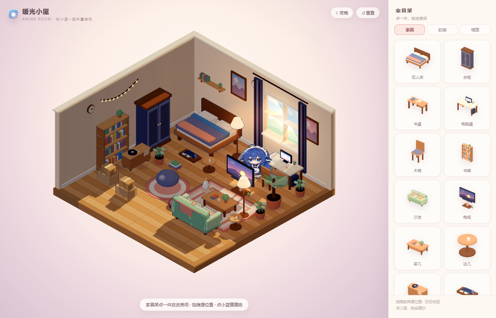

# dsh-cozy-room · 暖光小屋

A cozy anime isometric room that lives **behind** your DeepSeek Harness window.

Decorate it freely, watch a little blue-haired maid go about her day, and pull her out onto your desktop whenever you want to say hi. She notices when you are working: she thinks while you think, types when you run tools, cheers when a turn completes, and gets startled when something errors.

> 一个可以自由布置的动漫风小屋，作为 DSH 的背景层。屋里有位蓝发女仆「小蓝」：你工作时她也在电脑前忙，回合结束会雀跃，出错会被吓一跳；点右下角的 🐾 还能把她叫到桌面上陪你。



## Features

- **Isometric 8×8 room** with pastel cel shading, day/night switch, procedural furniture (bed, desk, sofa, TV, PC, console, robot, telescope…)
- **Free decoration**: place, drag, rotate, and remove furniture; the layout is saved in `localStorage`
- **A character who lives there**: 109 animation clips (idle, work, sleep, eating, playing, festivals…), random wandering, 1–8 actions per spot then move on
- **Work-state binding**: `thinking` → thinking bubble, `working` → typing at the desk, `waiting`, `success` → cheer, `error` → startled
- **Recall to desktop (🐾)**: she jumps out of the wallpaper as a transparent desktop pet with a sparkle effect, greets you, follows your clicks and drags; while she is out she leaves the room
- **Sleeping** is respected: if she is asleep, recall needs 3–5 clicks and she grumbles first; after returning she goes back to bed
- **Settings panel (⚙️)**: follow-work, night sleep, wandering, cat roaming, mouse parallax, pace, character size, summon effect
- **Action library (🎬)**: all 109 clips grouped by category, click to preview and to make her perform it
- **Cat** wanders, dozes and returns to her basket
- Everything runs locally — no network, no data collection

## Install

```bash
# from the DSH plugin manager, or
dsh plugin install dsh-cozy-room
```

> **Transparent theme required.** The room is a background layer (`z-index: -1`). If your DSH window paints an opaque background you will not see it. Install a transparent/glass theme (for example `dsh-plugin-wallpaper-engine` → 液态玻璃) and keep only **one** theme plugin controlling the background.

> **需要透明主题。** 房间是背景层（`z-index: -1`），如果窗口背景是不透明的就看不到。请装一个透明/玻璃主题（例如 `dsh-plugin-wallpaper-engine` 的液态玻璃），并且**只开一个**管背景的主题插件。

Then restart / refresh the Web UI (`Ctrl+R`). The room appears behind the chat; three buttons sit at the bottom-right:

| Button | What it does |
| --- | --- |
| ⚙️ | Settings (work binding, sleep, wandering, pace, size, effect) |
| 🐾 / 💤 / ↩ | Recall her to the desktop / call her while asleep / send her back |
| 🏠 | Enter room mode: drag furniture, click her (Esc to exit) |

## How it works

- The host half starts a tiny static server on `127.0.0.1:8140` (auto-increments if the port is taken) that serves the bundled `room/` folder.
- The browser half mounts an iframe as a fixed background layer (`z-index: -1`, click-through) and talks to the room over `postMessage`.
- `/status.json` exposes the current session state, `/health.json` lets the client find the right port.
- The room itself is a standalone Three.js page — it also runs by itself from `room/index.html`.

## License & credits

- Code: MIT (see `LICENSE`)
- Character animations: from **[dsh-pet](https://github.com/PC2005-cloud/dsh-pet)** by PC2005-cloud — **non-commercial**, attribution required (see `CREDITS.md`)

## Development

```bash
# room only, no DSH
cd room && python -m http.server 8000
```

Environment variables:

- `DSH_COZY_ROOM_DIR` — serve a different room folder
- `DSH_COZY_ROOM_PORT` — preferred port (defaults to 8140, scans up to +11)
